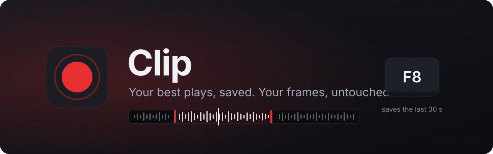
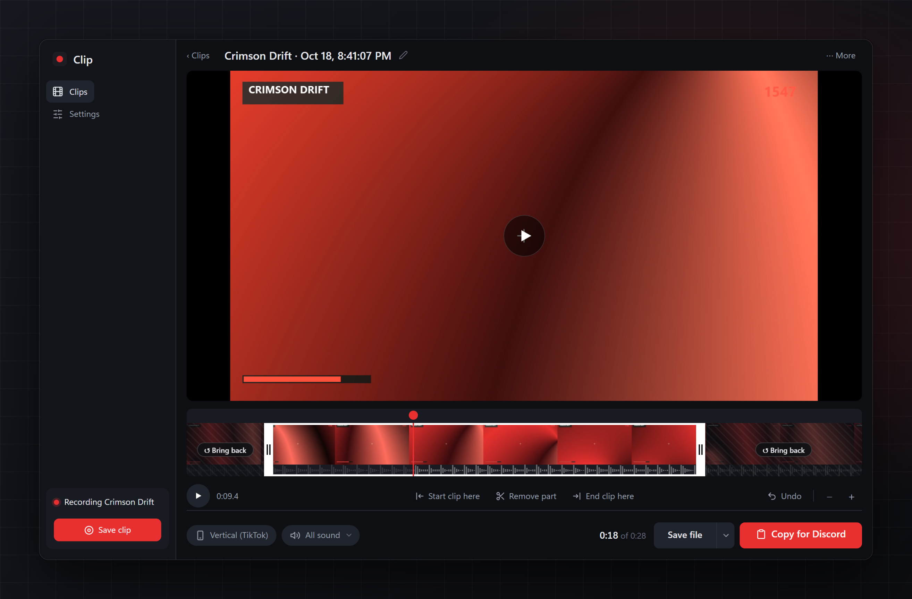
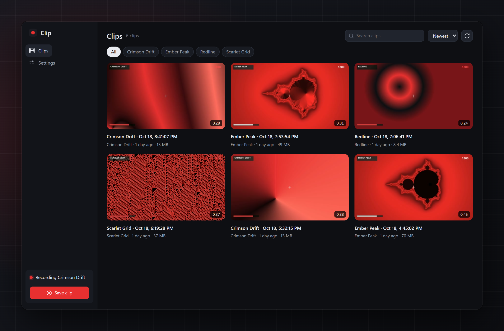
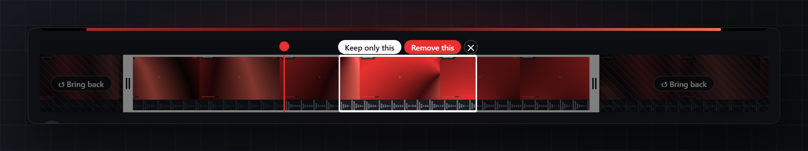
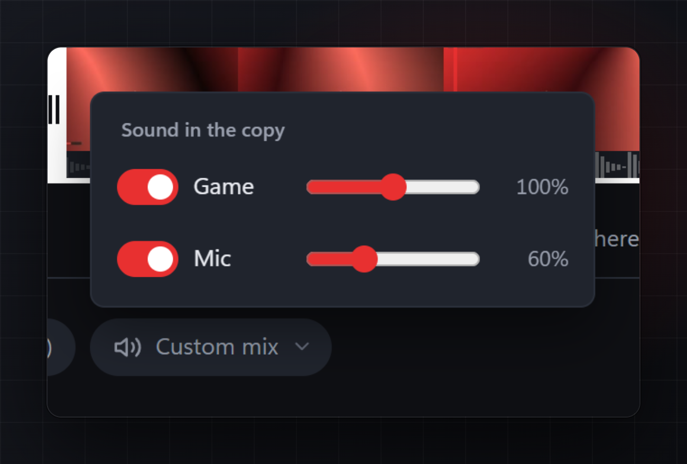
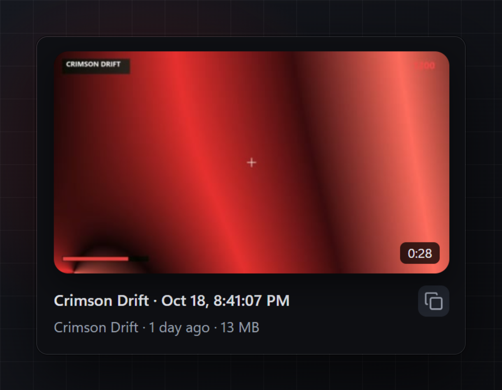
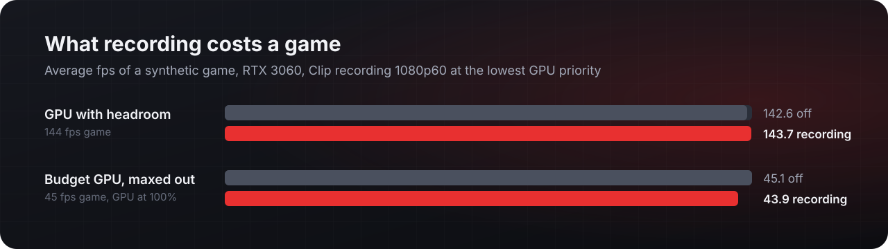

<p align="center">
  
</p>

<p align="center">
  <a href="https://github.com/luca-bv/clip/releases/latest"></a>
  <a href="https://github.com/luca-bv/clip/actions/workflows/build.yml"></a>
  <a href="LICENSE"></a>
</p>

<p align="center">
  <b>Clip</b> records your game in the background and saves the last 30 seconds the moment you press <kbd>F8</kbd>.<br>
  Trim it, crop it for TikTok, and paste it straight into Discord. Free, open source, and built so your game keeps every frame.
</p>

<p align="center">
  
</p>

<br>

<table>
<tr>
<td width="56%"></td>
<td>

### Every play, one place

Recording starts by itself when a game goes fullscreen. Press <kbd>F8</kbd>, double-tap <kbd>Right Ctrl</kbd> or say *"Hey Clip, save that"*: a chime plays at once and the last 15 seconds to 5 minutes are saved.

Clips sort themselves by game, with the game's real name, and open instantly from cached previews.

</td>
</tr>
<tr>
<td>

### One strip does everything

Drag the white edges to trim. Drag across the strip to select a stretch, then **Keep only this** or **Remove this**. Removed parts stay one click from coming back, and every change can be undone.

The filmstrip and waveform are ready the moment a clip opens, and scrubbing shows the picture under your mouse instantly.

</td>
<td width="56%"></td>
</tr>
<tr>
<td width="56%"></td>
<td>

### Game and mic, apart

Game, microphone and any app playing sound are recorded on their own tracks. Switch each off, or set its volume from 0 to 200%. You hear the mix as you set it, and the copy uses it.

</td>
</tr>
<tr>
<td>

### One paste into Discord

Hover a clip and hit copy, or let Clip copy each new clip for you. One <kbd>Ctrl</kbd>+<kbd>V</kbd> in Discord attaches the video and its caption. Exports fit Discord's 10 MB, come in 1080p or 720p, or get cropped to 9:16 for TikTok, Shorts and Reels.

</td>
<td width="56%"></td>
</tr>
</table>

## Your frames stay yours

Capture, colour conversion and encoding all run on the GPU's video hardware (NVENC, AMF or Quick Sync) at the lowest GPU priority. Clip's own thread spends about half a millisecond per frame, and waiting in the tray it uses about 35 MB of memory.

<p align="center">
  
</p>

On a budget card the video encoder is a separate block of the chip, so the cost stays this small: anything with NVENC (GTX 10-series and newer), AMD VCE/VCN (RX 400 and newer) or Intel Quick Sync (any recent iGPU) works. Clip keeps the buffer in RAM (about 75 MB for 30 seconds at the default 20 Mbit/s), never on your disk, and makes previews while no game is recording (or while you have Clip open).

## Get it

Download **Clip.zip** from the [latest release](https://github.com/luca-bv/clip/releases/latest), unzip it anywhere and run `Clip.exe`. Clip adds itself to the Start menu, waits in the tray and starts with Windows.

Or install and update from Git Bash:

```bash
curl -fsSL https://raw.githubusercontent.com/luca-bv/clip/main/install.sh | bash
```

Add `-s -- --uninstall` after `bash` to remove it. Your clips and settings stay.

**Needs** Windows 11 and a GPU with a hardware H.264 encoder.

## Shortcuts

| Key | What it does |
| --- | --- |
| <kbd>F8</kbd> | Save the last 30 seconds (change it in Settings) |
| <kbd>Right Ctrl</kbd> <kbd>Right Ctrl</kbd> | Same, as a double tap (any key, or off) |
| <kbd>Space</kbd> | Play or pause in the editor |
| <kbd>I</kbd> / <kbd>O</kbd> | Start or end the clip at the playhead |
| <kbd>S</kbd> | Cut out a short stretch around the playhead |
| <kbd>Enter</kbd> / <kbd>Delete</kbd> | Keep only, or remove, the selection |
| <kbd>←</kbd> <kbd>→</kbd> | One frame back or forward (hold <kbd>Shift</kbd> for one second) |
| <kbd>+</kbd> <kbd>-</kbd> <kbd>0</kbd> | Zoom the strip in, out, or to the whole clip |
| <kbd>Ctrl</kbd>+<kbd>Z</kbd> | Undo (<kbd>Ctrl</kbd>+<kbd>Y</kbd> redoes) |

## Privacy

Clips never leave your PC unless you share them. Clip has no accounts, no uploads and no telemetry. It talks to the internet for two things only: Discord's public list of games, so it can call `robloxplayerbeta.exe` "Roblox" (cached for a week), and Discord itself, when the Discord activity is on.

<details>
<summary><b>Settings, files and logs</b></summary>

<br>

Everything is in the settings window. Behind it:

| | |
| --- | --- |
| Settings | `%APPDATA%\Clip\config.toml` (edits apply while Clip runs) |
| Clips | `Videos\Clip\<game>\`, exports in `Videos\Clip\Exports\` |
| Previews | `%LOCALAPPDATA%\Clip\cache\` (safe to delete; remade when needed) |
| Log | `%LOCALAPPDATA%\Clip\clip.log` |

Defaults: 30 second clips, 60 fps, up to 1080p, 20 Mbit/s. Frame rate, resolution and bitrate apply from the next game.

Under *Settings → General → Credit* you can turn off the small "Clipped with Clip" badge on shared copies, the `#ClippedWithClip` paste text and the Discord activity. Saved clips never have a badge.

</details>

<details>
<summary><b>Build it yourself</b></summary>

<br>

CI builds every push ([workflow](.github/workflows/build.yml)). Locally you need Visual Studio 2022 or newer, CMake, and an [LGPL shared FFmpeg build](https://github.com/BtbN/FFmpeg-Builds/releases) unzipped to `ffmpeg/`. The WebView2 SDK is fetched by CMake.

```bash
cmake -B build -A x64
cmake --build build --config Release
```

`cmake --build build --config Release --target clip_bench` builds the bench behind the chart above (`clip_bench 5`), and checks that recording and exporting work on your GPU (`clip_bench smoke out.mp4`).

</details>

## Built with

[FFmpeg](https://ffmpeg.org) (LGPL, linked dynamically) · [wavesurfer.js](https://wavesurfer.xyz) (BSD-3) · [toml++](https://github.com/marzer/tomlplusplus) (MIT) · [WebView2](https://developer.microsoft.com/microsoft-edge/webview2/) · Windows Graphics Capture

<sub>The games in the screenshots are made up.</sub>

Clip is [MIT licensed](LICENSE).
